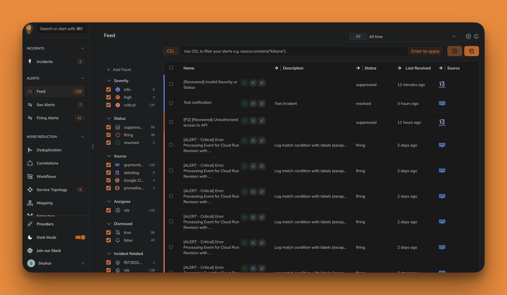

## 定位与边界

监控采集不归更夫管——Zabbix、Prometheus、夜莺、云监控继续各司其职。更夫承接的是告警产生之后的一切：

```
监控层（夜莺 / Prometheus / Zabbix / 云监控 / 日志系统）
        │  webhook / API 接入
        ▼
更夫：接入汇聚 → 去重降噪关联 → 值班与通知（钉钉 / 企微 / 飞书）
        → 事件管理 → AI 分析与报告 → 工作流自动化处置
```

## 产品一览



## 为什么做更夫

上游 [Keep](https://github.com/keephq/keep) 是一款优秀的开源 AIOps 平台，但它是围绕海外生态设计的：没有钉钉、企业微信、飞书，没有阿里云/腾讯云监控；界面与 AI 默认英文，AI 后端默认 OpenAI/Anthropic；认证默认对接 Auth0/Okta 等 SaaS IdP。放进国内企业环境，"能跑起来，却用不起来"。

而国内监控采集层已经非常成熟，真正碎片化的是**告警之后的第一公里**：告警风暴无人收敛、值班靠人肉盯群、事件处置没有沉淀、AI 分析基本空白。商业 AIOps 客单价在百万级，开源侧只有"消息转发器"，没有完整的聚合、事件与 AI 平台。

这个空档就是更夫的立足点：**以 MIT 协议的 Keep 为底座，做一款中国企业场景真正可用的开源告警聚合与 AI 事件管理平台。** 中文化只是第一层，核心是补上国内生态的三块短板：国内 IM 触达、国产大模型接入、内网私有化部署。

::: tip 推荐上手路径
[快速上手](/quickstart)（10 分钟从安装到收到第一条钉钉告警）→ [接入夜莺](/nightingale) → [值班排班路线](/oncall-roadmap)
:::

## 与上游 Keep 的关系

本仓库是 [keephq/keep](https://github.com/keephq/keep)（MIT License）的中文发行版。更夫独立演进、不向上游回馈 PR；每季度审阅上游变更，安全与核心修复按需 cherry-pick 吸收。MIT 许可证与版权声明完整保留。

阅读左侧/顶部导航中的使用文档，了解更夫（Keep 内核）的完整能力：告警、事件、工作流、Providers、部署与 CLI。
